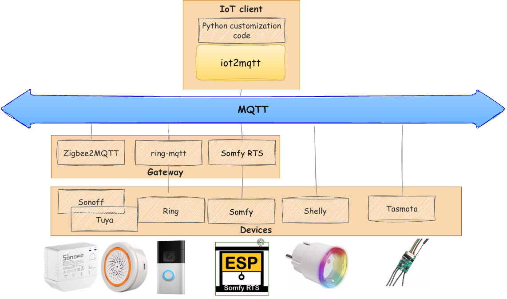
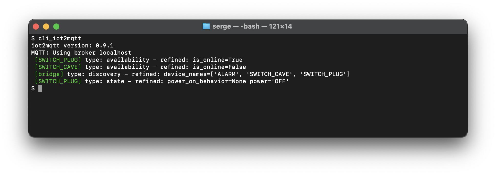

# iot2mqtt: Simplifying IoT Solutions with MQTT Integration

***"Less is More"***

## Introduction

**iot2mqtt** is a versatile Python library built upon the Paho™ MQTT client. It is designed to simplify IoT application development by providing a programmatic alternative to traditional home automation platforms, without the overpromises of no-code solutions.



## Description

**iot2mqtt** offers a robust and flexible solution for integrating various IoT devices using the MQTT protocol. Whether you are looking to connect directly with devices or through gateways, **iot2mqtt** provides the tools you need to build reliable and scalable IoT applications.

### Key Features

- **Programmatic Alternative**: Provides more flexibility and control compared to traditional home automation platforms like openHAB, Home Assistant, and Jeedom.
- **Reliable Communication**: Leverages the MQTT protocol to ensure reliable data transfer between devices.
- **Protocol-Agnostic**: Supports both direct device integration over MQTT (e.g., Shelly, Tasmota) and gateway integration (e.g., [zigbee2mqtt](https://github.com/Koenkk/zigbee2mqtt), [ring-MQTT](https://github.com/tsightler/ring-mqtt), [ESPSomfy RTS](https://github.com/rstrouse/ESPSomfy-RTS)).
- **Abstract Devices**: Comprehensive support for creating and managing abstract devices, simplifying the integration between different device models, providers, and protocols.

## Getting Started

To get started with **iot2mqtt**, follow these steps:

### Prerequisites

- Python 3.x
- IoT bridges if required (e.g., Zigbee2MQTT, ESPSomfy RTS)

### Installation

The latest stable version is available in the Python Package Index (PyPi) and can be installed using

```bash
pip3 install iot2mqtt
```

or with `virtualenv`:

```bash
python3 -m venv venv
source venv/bin/activate  # On Windows use `venv\Scripts\activate`
pip3 install iot2mqtt
```

### Installation from Github

To obtain the code, you can clone the Github repository:

1. Clone the repository:

    ```bash
    git clone https://github.com/slassabe/iot2mqtt.git
    ```

2. Navigate to the project directory:

    ```bash
    cd iot2mqtt
    ```

3. (Optional) Create and activate a virtual environment:

    ```bash
    python3 -m venv venv
    source venv/bin/activate  # On Windows use `venv\Scripts\activate`
    ```

4. Install the required dependencies:

    ```bash
    sudo pip3 install -r requirements.txt
    ```

## Test installation

To verify that the installation was successful, you can use the `cli_iot2mqtt` command. This command will help you ensure that everything is set up correctly.

1. Open your terminal.
2. Run the following command:

   ```sh
   cli_iot2mqtt
   ````

You should see output similar to the screenshot below, indicating that the command is working as expected.



## Supported Devices and Protocols

The **iot2mqtt** library supports device integration across multiple protocols. Device modules are loaded dynamically using the `load_devices_for_protocols()` function.

### Supported Protocols

| Protocol | Description | Status |
| -------- | ----------- | ------ |
| Z2M | Zigbee2MQTT bridge devices | ✓ Supported |
| ESPSOMFY | ESPSomfy RTS motorized shades | ✓ Supported |
| RING | Ring security devices | ✓ Supported |
| SHELLY | Shelly WiFi devices | ✓ Supported |
| TASMOTA | Tasmota firmware devices | ✓ Supported |

### Device Models

| Protocol | Model | Device Type | Reference |
| -------- | ----- | ----------- | --------- |
| Z2M | CTP-R01 | Magic Cube | [Link](https://www.zigbee2mqtt.io/devices/CTP-R01.html) |
| Z2M | E3 | Door Contact Sensor | [Link](https://www.zigbee2mqtt.io/devices/E3.html) |
| Z2M | HM1RC-2-E | Alarm Button | [Link](https://www.zigbee2mqtt.io/devices/HM1RC-2-E.html) |
| Z2M | HS1SA | Smoke Sensor | [Link](https://www.zigbee2mqtt.io/devices/HS1SA.html) |
| Z2M | NAS-AB02B2 | Alarm | [Link](https://www.zigbee2mqtt.io/devices/NAS-AB02B2.html) |
| Z2M | S26R2ZB | Smart Plug | [Link](https://www.zigbee2mqtt.io/devices/S26R2ZB.html) |
| Z2M | SNZB-01 | Button | [Link](https://www.zigbee2mqtt.io/devices/SNZB-01.html) |
| Z2M | SNZB-02 | Air Sensor | [Link](https://www.zigbee2mqtt.io/devices/SNZB-02.html) |
| Z2M | SNZB-02D | Air Sensor (Display) | [Link](https://www.zigbee2mqtt.io/devices/SNZB-02D.html) |
| Z2M | SNZB-02P | Air Sensor (Probe) | [Link](https://www.zigbee2mqtt.io/devices/SNZB-02P.html) |
| Z2M | SNZB-03 | Motion Sensor | [Link](https://www.zigbee2mqtt.io/devices/SNZB-03.html) |
| Z2M | SNZB-03P | Motion Sensor Plus | [Link](https://www.zigbee2mqtt.io/devices/SNZB-03P.html) |
| Z2M | SRTS-A01 | Thermostat / Blind Controller | [Link](https://www.zigbee2mqtt.io/devices/SRTS-A01.html) |
| Z2M | TS0601_soil | Soil Sensor | [Link](https://www.zigbee2mqtt.io/devices/TS0601_soil.html) |
| Z2M | ZBMINI-L | Switch Module | [Link](https://www.zigbee2mqtt.io/devices/ZBMINI.html) |
| Z2M | ZBMINIL2 | Switch Module L2 | [Link](https://www.zigbee2mqtt.io/devices/ZBMINIL2.html) |
| RING | RingAlarm | Alarm System | [Link](https://github.com/tsightler/ring-mqtt/wiki#supported-devices-and-features) |
| RING | RingCamera | Camera | [Link](https://github.com/tsightler/ring-mqtt/wiki#supported-devices-and-features) |
| RING | RingChime | Chime | [Link](https://github.com/tsightler/ring-mqtt/wiki#supported-devices-and-features) |
| ESPSOMFY | E3 | Motorized Shades | [Link](https://github.com/rstrouse/ESPSomfy-RTS) |
| TASMOTA | Shelly Plug S | Smart Plug | [Link](https://templates.blakadder.com/shelly_plug_S.html) |
| TASMOTA | Shelly Uni | Multi-purpose Module | [Link](https://templates.blakadder.com/shelly_UNI.html) |

## Related projects

- [ESPSomfy RTS](https://github.com/rstrouse/ESPSomfy-RTS) : A controller for Somfy RTS shades and blinds
- [paho-mqtt](https://github.com/eclipse/paho.mqtt.python) : Eclipse Paho™ MQTT Python Client
- [https://github.com/pydantic/pydantic](https://github.com/pydantic/pydantic) : Data validation using Python type hints
- [miflora-mqtt-daemon](https://github.com/ThomDietrich/miflora-mqtt-daemon) : Xiaomi Mi Flora Plant Sensor MQTT Client/Daemon
- [ring-mqtt](https://github.com/tsightler/ring-mqtt) : Ring devices to MQTT Bridge
- [zigbee2mqtt](https://github.com/Koenkk/zigbee2mqtt) : Allows you to use your Zigbee devices without the vendor's bridge or gateway.
